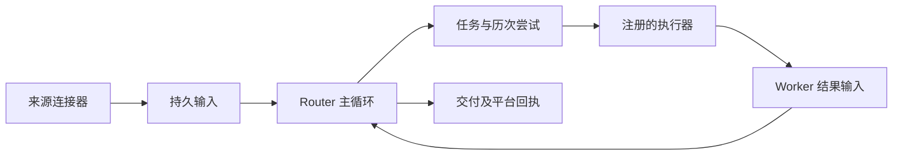

# ZeRo 主动监听与情境路由

操作说明与完整设计

## 第一阶段使用说明

在运行 ZeRo 的电脑上打开 Web 配置页的「监听与收件箱」。命中的事件会出现在同页的「事件收件箱」。每个仓库可选择 GitHub 签名 webhook 或默认的 5 分钟轮询，也可单独启用外部 CI 推送。对于微信，ZeRo 向本机 WXARC 发起长等待，有新文字事件就接收并筛选。关掉网页后，ZeRo Server 继续监听。监听设置决定哪些事件进入收件箱，第二阶段的路由设置决定哪些事件随后交给 Agent 处理。[打开本机监听配置](http://localhost:3001/config?tab=listeners)

| 来源 | 选择和保存 | 从何时开始 |
| --- | --- | --- |
| GitHub | 输入公共仓库的 `owner/repo` 并验证添加，或用只读凭证列出可见仓库。在仓库卡片上分别选择 Issue 和 PR 的状态变化、普通评论、Actions 失败或 PR 评论中的指定 @ 提及。选择 webhook 时填签名密钥引用，在仓库注册回调。 | Issue 普通评论和 PR 普通评论各自从该项启用时开始。其他轮询规则可按设置补读最近 1 或 24 小时。webhook 只处理实际投到端点且处于订阅时间范围内的事件。 |
| 外部 CI | 在所选仓库启用工作流失败条件，填写独立的 CI 签名密钥引用。CI 在构建失败时发送仓库、工作流、分支与稳定事件编号。 | 在 GitHub 两种接收方式下均可单独启用。符合条件的已签名报告入箱，同一事件重投只保留一条。 |
| WXARC | 启动本机 WXARC 服务。在配置页点「选择微信会话」，勾选允许观察的会话，各自填写要匹配的文字，启用并保存。关键词留空会接收该会话的所有新文字。 | 首次成功连到 `127.0.0.1:8765` 后记下当时的文字流末尾，随后处理新事件。只有被选会话中符合条件的文字进入本机收件箱。 |

公共仓库可将 GitHub 凭证名称留空。私有仓库使用只授予目标仓库和所需读取权限的令牌，通过现有 Secrets 管理流程以 `github_listener` 或带后缀的名称保存，例如 `github_listener_team`。监听配置中填写这个名称。GitHub API 令牌、GitHub webhook 密钥、外部 CI 密钥分别使用不同的引用。仓库管理员需另行将可访问的 HTTPS 回调路径登记到 GitHub。[CLI 手册的 Secret 管理](zero-cli.md#secret-管理) · [GitHub 与外部 CI 接入步骤](trigger-webhooks.md)

**为仓库绑定 GitHub App。** 安装时选择目标仓库；监听 Issue 和 PR 只需相应的读取权限。绑定后，仓库卡片会显示 App 凭证引用，例如 `github_app_zero_router`。私钥保存在本机独立加密文件 `.zero/github-app/credentials.enc`，用于为该 App 换取短期安装令牌。监听和读取权限检查始终使用只读令牌，仓库列表沿用原有连接。App 身份与评论中的提及筛选分别配置；安装 App 不保证 GitHub 会在每条讨论的 `@` 候选列表中显示它。[GitHub 提及规则](https://docs.github.com/en/get-started/writing-on-github/getting-started-with-writing-and-formatting-on-github/basic-writing-and-formatting-syntax#mentioning-people-and-teams)

**检查所选规则的读取权限。** 在仓库卡片上点「检查读取权限」，可以先验证，再决定是否保存、启用监听。勾选 Issue 或 PR 状态变化时，检查相应的仓库读取权限。勾选工作流失败时，检查 Actions 运行列表。选取普通评论或填写 PR 提及账号时，检查仓库评论接口。若还为提及规则限制目标分支，再检查 PR 列表。结果按项标明可读、拒绝、找不到或不可见、限流或暂不可用。留空凭证时显示匿名访问，成功仅说明公开资源可读。检查只看 GitHub 的响应状态和头部，无需展示评论、运行记录或凭证内容，也不会产生收件或提醒。

**验证轮询与微信收件。** 在有近期失败构建的仓库选择轮询并启用 Actions 失败规则，并选择覆盖该构建的补收窗口。保存后点「立即检查」，稍候点「刷新收件箱」。找到对应的仓库和运行记录，打开 GitHub 原始运行链接，核对工作流、时间与失败状态。重复检查时，同一次运行的同一次尝试只保留一条记录。若验证微信，先等所选会话成功建立读取进度，再用该会话中新出现、且符合关键词的文字核对收件箱。

**验证签名回调。** 在目标仓库的 Recent deliveries 确认 ping 返回 200，再用新失败的工作流或匹配的 PR 评论核对收件箱。开发验收从 GitHub 读取 bun-types 的真实失败运行，使用隔离密钥在本机并发回放两次，收件箱与 Web 提醒各产生一条记录。分析器使用测试替身。此次验收未在公网仓库注册 webhook。[用于回放的 GitHub 运行](https://github.com/oven-sh/bun/actions/runs/41696246682) · [查看投递回执](trigger-webhooks.md#投递回执)

**暂停与恢复。** 取消某个仓库或微信会话的「启用监听」，保存后即暂停。再次勾选并保存会重新建立这条规则的起点，可按上表选择 GitHub 补收范围。正常重启后，轮询和 WXARC 会从已保存的位置续读。webhook 依靠发送端重投未成功的回调。配置、读取位置与收件箱保存在 ZeRo 数据目录的 `listeners/inbox.sqlite`，默认位置为 `.zero/listeners/inbox.sqlite`。

## 第二阶段使用说明

**先启用，再选要复核的事件。** 主动处理默认关闭。在配置页的「Agent 与通知路由」勾选「启用 Agent 与通知路由」，选择去向，点「保存路由设置」。启用后，新写入收件箱的匹配事件会进入处理队列。已有收件记录保留原状，可打开一条记录，点「分析并路由通知」手动处理。如果在路由启用后才给 GitHub 规则设置历史补收，补收产生的新收件记录也会进入队列。摘要 Agent 会将命中事件的标题和有限正文片段提交给 ZeRo 配置的模型，只生成简短摘要。

**按作息选择去向。** 配置时区、工作日和工作时间，然后为工作时段、工作日的其他时间、休息日分别选择网页、微信、钉钉、飞书或延后。跨午夜的班次归起班日。例如，周五工作时间设为 22:00 到次日 06:00，周六 05:30 仍按这个工作时段路由。在「假日与补班」中可为具体日期指定上班或休息。指定休息日从当地零点生效，会截断前一天的夜班。

当首选为 Web 时，选择「手动 · 在电脑前」，或选择自动判断并在最近两分钟内实际操作过网页，才能立即投到网页。手动离开或活动已过期时，默认延后。选择微信、钉钉或飞书作离开时的备选后，Router 会选择该平台已指定的机器人。机器人离线或渠道还不能确认主动提醒应发给谁时，提醒会延后。系统在接近时段边界时重新判断，其他延后事项至多五分钟后再次检查。[时段与在场规则](../packages/shared/src/trigger-routing-policy.ts)

**保存前试一次。** 展开「情境预演」，选择一个时间，再切换「手动 · 在电脑前」和「手动 · 已离开」，观察同一条提醒的去向和理由。预演假设当前草稿已启用，输入时间按设备时区解释，再换算到规则时区。可分别模拟已选机器人能否投递。预演只在浏览器中计算。

**可选的 Mac 在场判断。** 如果 ZeRo 服务就运行在日常使用的 Mac 上，可在「Mac 在场信号」开启锁屏和空闲检查，并指定几分钟无操作后算离席。勾选后，手动在场或网页有近期活动仍需 Mac 处于解锁且未超时状态。无法获取有效观测时按「网页无人时」处理。可另行开启蓝牙音频连接检查，它仅补充已确认的在场说明。检查默认关闭，开启后在路由判断时读取，观测最多沿用 30 秒。设备名称不进入持久化记录或模型上下文。可在情境预演中模拟，预演不会访问系统设备。

**选择 Router 专用机器人。** 在「Router → 通知渠道与路由设置」或「配置 → 监听与收件箱」为微信、钉钉、飞书分别选一个已接入的机器人，再选择各时段和离席时的通知去向。保存即生效。选中机器人的旧普通 Agent 绑定会解除，历史可在「会话」中查看。取消选择后，下一条普通消息可以建立新的 Agent 会话。暂停自动通知时，所选机器人仍由 Router 接管。

**收消息与主动提醒。** 和选中的机器人对话时，它在原处回复。GitHub 等外部事件需要主动提醒时，渠道会复用这个机器人已确认的唯一私聊。第一次使用、尚无私聊记录时，给它发一条私聊即可。只有群聊或存在多个可能的收件人时，主动提醒会延后。旧版已明确指定的地址继续生效，已撤销的绑定也会保留。收到个人提醒后，可以回复「#监听123 进展如何」，把 123 换成提醒里的编号。WXARC 的监听会话只决定从哪里收取事件，它触发的个人 IM 提醒仅给出编号和本机回看提示。[打开 Router](http://localhost:3001/router)

在已确认的本人私聊，可以直接问「现在的提醒会发到哪里」。Router 使用这个机器人与你的私聊历史回答，网页主对话和旧 Agent 会话分别保存。带编号的任务追问、委托确认和卡片按钮继续按各自的授权处理。在本人私聊授权 GitHub 连接后，也可以直接列出可见仓库，或把分析工作交给 ZeRo。

跟踪一个仓库后，可以在同一段对话中问「这个项目里有哪些开放的 PR」。Router 会从最近的跟踪或查询回执确定仓库，用当前入口的 GitHub 授权实时读取开放 PR。微信每页最多 5 条，显示编号、短标题和草稿标记。重新问有哪些 PR 会实时读取第一页。回复「下一页」继续，「那第一页呢？」会回到同一仓库的第一页。回复「PR 185」可查看刚才那一页中 185 号的完整标题和原文链接。飞书用卡片、钉钉用带链接的标题、网页用可点击的列表，每页最多 10 条。若刚看到多个仓库，可以用列表序号或仓库全名指定一个。

**验证一条网页提醒。** 将当前时段的去向设为「网页」，在场状态选「手动 · 在电脑前」，保存。打开一条尚未处理的真实 GitHub 收件记录，记下编号，点「分析并路由通知」。稍后刷新「路由记录」与「网页通知」，用相同编号核对摘要、路由原因和原始 GitHub 链接。「网页通知」只列实际投到 Web 的事件。其他渠道及延后事项可在「路由记录」查看。若在其他页面收到「有新的网页提醒」，点击提示可查看已投递的网页通知。[打开本机路由记录](http://localhost:3001/config?tab=listeners#routing-records)

**查看委托的网页提醒。** 网页打开时，Router 投递成功即可唤醒本机页面。单条委托提醒可直接打开对应任务，多条新提醒会合并提示。Router 工作台的「网页提醒」按实际投递时间列出普通事件与委托的摘要。同一事件命中两份委托时，每一份都有自己的任务入口。首次使用从当前投递序号开始提示。浏览器允许本地存储时，会记住已提示的序号，关页再打开可看到离开期间的新提醒。实时连接仅通知页面重新检查，本机页面打开记录时才读取标题与摘要。[打开网页提醒记录](http://localhost:3001/router?view=notifications)

**暂停与恢复。** 关闭全局路由时，来源仍可接收事件。重新启用后，此前已排队且来源授权未变的工作会继续，暂停期间新入箱的事件可逐条手动提交。停用某个来源规则或修改其筛选条件时，原规则尚未投递的自动任务会撤销。需要补办的记录可以单独点「重试通知路由」。

**IM 投递状态。** 「路由记录」会显示延后的原因和下次复查时间。最终投递后仍可查看首次延后的时间与理由。若 Agent 分析失败、分析中断或平台明确拒收，可以排除问题后点「重试通知路由」。若发送已开始，随后连接中断、服务重启或平台回执不明确，该条记录会保留为待确认。可在原接收会话核对收件编号，ZeRo 停止自动重发。平台已受理表示平台确认接收了这次发送。

## Router 工作台

Router 按具体目标承接工作，已明确授权的动作在同一事项内持续有效，无需先设置统一的仓库维护授权。主动发现的问题先完成核查、去重和具体方案准备；例如 PR 存在缺陷时，准备带版本、复现、修改建议和验收要求的评论草稿。没有外发授权的草稿不会自动发布，也不会因为审查结束就将待决定事项结案。

同一次决定可以处理的相关成果集中呈现，各自保留原事项与 Worker。确认只适用于展示的具体对象和动作，不转为长期授权。用户要求反馈并跟进修订后，Router 保存发布回执及等待条件，新回复或提交到来时续办原 Worker；没有变化时不重复催问。明确只要求分析或审查的任务仍按该范围交付，反馈授权不包含合并。

批次范围或决定变化时，原事项保存共同交付事项及最新决定，Worker 返回后先核对共同交付范围，避免分别重复询问。飞书和钉钉需要决定的卡片同时提供可点击操作；飞书可显示具体选项，当前钉钉模板使用一个「确认」按钮，正文明确点击对应的具体对象、动作和限制。发布反馈、实施、合并分别决定；钉钉的多个独立决定按原事项分别交付单按钮卡片，不把其余决定退回私聊打字。已批准的动作不重复请求确认，普通进展不附无意义的确认按钮。

**Router 如何分发。** 工作台把当前请求交给 ZeRo 的 LLM 主循环。模型按需查询机器人或预演当前去向，读回工具结果后，再决定是否通知、准备跟踪委托或向你追问。当前去向使用运行时的时钟、在场信号和已保存的规则计算。工具按对话范围开放，Router 的工具集不包含终端和文件读写。回复下方可以展开本轮实际调用的工具。

**列出当前连接可见的仓库。** 在「配置 → 监听与收件箱 → GitHub」填写已存入 Secrets 的只读凭证名称并保存，网页 Router 就能查询。要在 IM 中使用，在同一页的「Router 读取 GitHub」勾选对应机器人并保存，授权限于该机器人已验证的本人私聊。查询无需开启仓库监听，也不会添加订阅。「看看我的 GitHub 仓库」会返回带编号的仓库全名，可能包括协作仓库和组织仓库。可继续问「下一页」，也可以用「第二个」指刚列出那一页的第二项。

**把一次工作交给执行器。** 例如先问仓库列表，再说「帮我分析第二个仓库最近一次发布失败」。Router 为这次工作建立独立派工，ZeRo 可以在授权范围内分析 GitHub 运行和作业。代码修改交给 Codex。已跟踪仓库可自动建立专用工作副本，也可指定已有目录。本人网页和已核实的机器人私聊共用仓库配置。每项派工都带编号。回到原对话说「查看派工 #12 的进度」可查结果，说「继续派工 #12，重点看失败步骤」可补充要求。网页会更新正在执行的工作。在 IM 中，主动回报按当前通知策略和原私聊授权决定，也可以主动查询。[配置 Codex 工作目录](zero-cli.md#router-的-codex-工作目录)

**临时给自己发一条通知。** 在主对话明确说「现在发微信提醒我处理 DeepSeek 的充值」，Router 会通过已选微信机器人发送，并展示平台回执。也可以指定钉钉或飞书。想先看正文时，说「帮我拟一条微信提醒」，补齐内容后会得到可核对和发送的草稿卡。两种用法都无需订阅或收件箱事件。平台已受理、拒收和回执未知会分别显示。回执未知时可在对应的机器人私聊核对。

微信发送接口成功返回的 JSON 空对象 `{}` 也是有效回执，Router 将它标记为「平台已受理」。微信明确拒收时，卡片显示返回的数值错误码或 HTTP 状态。连接超时、响应正文为空或回执格式无法识别时，卡片显示「待核对」，以免重复通知。平台受理后，是否出现在微信里仍以聊天记录为准。[腾讯微信插件的发送测试](https://github.com/Tencent/openclaw-weixin/blob/v2.4.10/src/api/api.test.ts#L182-L213)

从 ZeRo Web 导航选择「Router」即可进入通用对话。在工作台选中一条 GitHub 或 WXARC 记录，或在收件箱点「在 Router 中继续」，即可打开这条事件自己的对话。事件链接带有本机收件编号，例如 `/router?event=42`。刷新页面或通过同一链接回来，可以接着问。[打开本机 Router 工作台](http://localhost:3001/router)

收件箱默认隐藏已核验由绑定 GitHub App 发出、或与本机成功发送回执匹配的评论；勾选「显示自身产生的事件」可查看，列表和详情均标记「自身产生」。事件仍保留并进入 Router 的判断流程，作为原事项的交付证据，不应仅因回流重复派工或通知。用户本人在 GitHub 追加的评论仍按新输入处理。历史记录仅凭已有身份标记或成功发送回执回填，不凭评论正文猜测来源。

列表和事件卡优先展示当前 Router 输入及其实际 Worker 执行状态，例如「Worker 正在处理」「Router 正在处理 Worker 结果」；通知路由状态仍用于通知记录。「Router 已处理」表示该输入已处理，不表示整个事项已完成。

| 想知道什么 | 在哪里操作 | Router 用什么回答 |
| --- | --- | --- |
| 「周六我不在电脑前，新提醒会发到哪里？」 | 在通用对话里提问，或展开「情境预演」，选择周六和离开状态。 | 对话使用已保存的通知偏好和订阅数量。预演由浏览器按当前规则试算，可模拟所选机器人能否投递。 |
| 「这次构建失败为什么先延后，后来又投到网页？」 | 选中那条构建事件，查看卡片上的路由记录，再追问「如果我一直没回来呢？」 | Agent 可使用本条事件的片段、摘要、实际决策和此对话最近的已完成问答。卡片显示已记录的事实，追问可讨论其他情境。 |
| 「这条事件接下来能怎么处理？」 | 点事件卡片的「建议下一步」。需要按当前偏好投递时，点「分析并路由通知」。 | 建议可以带一张后续步骤卡。显式提交事件会进入现有摘要和路由流程，可能按已保存的偏好发送通知。 |

**核对 GitHub 事件。** 在已选仓库的事件卡片点「查看 GitHub 事件详情」。对失败的工作流，Router 读取收件记录所指的那一次尝试，检查前 50 项作业，展示最多 4 项失败或超时作业及其失败步骤。首个失败作业可附上 GitHub Checks 标注和日志中可安全展示的运行器错误行。若日志不可读，卡片单独显示原因。「对比此前的运行」会核对上一次重跑，并从同工作流、同分支查询的最多 20 项中筛出相同来源仓库、相同触发方式的更早运行，列出最近 4 项。PR 评论事件则核对原评论与当前 PR 状态、目标分支。卡片标有获取时间和 GitHub 原始记录链接。调查结果保存在本条事件对话中，在这里追问时，模型可以看到已保存的精简证据。暂停的仓库只尝试匿名读取公开记录。调查不会重新运行 CI 或更改 PR。

**确认一项偏好变更。** 可以在对话里说「请把休息日的通知改成延后提醒」。Router 可给出一张变更建议卡。核对卡片上的全局设置，再点「确认应用偏好」。保存后，等待提醒的事件会按新规则复核。一次可改在场模式、一个时段的通知去向，或网页无人时的备选。建议关联提出时的规则版本。如果这段时间已在别处更新过规则，请重新提出。在对话中可明确指定已接入的机器人。核对建议卡中的平台和机器人账号，确认后生效。Router 保存的是账号选择和时段偏好，实际投递仍需该机器人在渠道侧就绪。

通用对话与各条事件的问答分别保存在本机。新问题由 ZeRo 配置的模型处理。通用对话不会自动附带收件箱正文。对 WXARC 事件提问时，模型可看到当前选中事件的文字片段。微信通知通过个人选定的 iLink 机器人发送。

在「Router → 任务」中打开一项任务，选择「继续任务对话」。每个任务拥有独立的聊天历史。同一事件同时命中发布提醒和研究归档两项委托时，两边各自保留问题、分析与投递记录。后续事件归入同一任务时可以接着问。任务会话使用最近 12 条命中记录解释进展。已归档任务可查看已有对话。IM 用户回复「#任务编号 问题」时，Router 核对实际投递的渠道、会话和操作者，只把已发给该受众的摘要及其自己的相关问答交给模型。本机管理员可在对应任务中看到这条追问。

工作台使用 A2UI v0.9.1 的受限组件集。服务端根据已保存的设置、实际事件状态或模型给出的回答要点生成卡片，浏览器渲染行、列、文字和按钮。点击按钮时，服务端按当前对话和卡片再次核对允许执行的动作。工作日、时段起止及三个平台的机器人选择可在 Router 或「监听与收件箱」编辑。配置页列出 GitHub 和 WXARC 监听来源，也会显示从 Router 启动跟踪的仓库。飞书和钉钉可以在授权会话中继续任务。微信私聊可回复「#任务编号 问题」，以已投递的摘要继续讨论。[A2UI v0.9.1 协议](https://a2ui.org/specification/v0.9.1-a2ui/) · [本机设置](http://localhost:3001/config?tab=listeners)

### Router 怎样跟进一件事

监听配置决定哪些线索可以进来。Router 先按来源提供的讨论标识、受众和授权查找之前办理这件事的 Worker。找到后，新线索排到同一个 Worker 的下一轮，带上此前核实的结论及来源。忙碌时按到达顺序等候。重复收到同一个事件只保留一份回执。

新事项由 Router 判断有没有具体问题可查、处理后能交付什么。值得做就自动派工。常规通知、简单致谢或机器人的回帖可留作观察。已核验的仓主明确指派核查时，直接使用已有授权。网页事件详情显示判断依据、Worker 编号、轮次和交付结果。持续委托仍可单独用于指定归档或通知目标，日常跟进无需新建委托。

GitHub 用仓库标识和 Issue 或 PR 编号关联原讨论。已开启 Actions 失败监听并授权 Router 读取的仓库，以原生运行编号关联重试。Worker 可以核对失败步骤、对比前次运行。独立签名的第三方 CI 事件沿用其订阅提醒。WXARC 只对已允许 Agent 处理的本机归档片段启用跟进，结果留在本机网页。归档中有明确引用时，ZeRo 核对同一已授权会话内近期入箱消息的引用关系。核对成功就交还原 Worker；缺少可靠引用时，消息各自判断。

### 让 Router 跟踪仓库的 Issue 和 PR

1. 在本机为目标仓库设置 GitHub 只读凭证。要同时跟踪 Issue 和 PR，给细粒度令牌选定仓库，并授予 `Issues: Read` 和 `Pull requests: Read`。在「配置 → 监听与收件箱 → GitHub」打开全局开关「允许 Router 跟踪 GitHub 仓库」。网页 Router 和已经获准读取该连接的 IM 入口共用此设置。[本机监听配置](http://localhost:3001/config?tab=listeners) · [GitHub Issues 权限](https://docs.github.com/en/rest/issues/issues#list-repository-issues) · [GitHub Pull requests 权限](https://docs.github.com/en/rest/pulls/pulls#list-pull-requests)
2. 在网页、微信、钉钉或飞书的 Router 对话里说「跟踪 `V1ki/dsh-plugin-subscriptions` 的 Issue 和 PR」可订阅状态变化。要收讨论内容，可以说「跟踪 `V1ki/dsh-plugin-subscriptions` 的 Issue 普通评论和 PR 普通评论」，也可只点名一种。仓库已在本次对话明确时可用「这个仓库」，有多个候选时可用全名或列表序号指定。
3. Router 核实仓库及读取权限后，将所选事件写入「监听与收件箱 → GitHub 仓库」。每个仓库只有一份 Router 跟踪配置。在微信已订阅 Issue 后，从网页再要求跟踪这个仓库的 PR，会在同一份配置中追加 PR。新仓库默认每 5 分钟检查一次。需要更快收到事件时，可在仓库配置签名 webhook。已有 webhook 的仓库沿用推送方式，需在 GitHub 的 webhook 上勾选相应事件。[配置 GitHub 推送](trigger-webhooks.md#github-设置)
4. 所选范围内的新事件自动交给 Router。可办理的问题会启动或续办后台 Worker。常规结果写回网页事件，有决定需要你做时再按路由偏好选择提醒时机和渠道。[打开 Router](http://localhost:3001/router)

撤销某个 IM 入口的 GitHub 读取授权，会停止该入口通过此连接读仓库、启动跟踪或接收跟踪提醒。已保存的仓库跟踪仍由 Router 运行。要停止某个仓库的监听，可在该仓库的配置卡片取消对应事件或暂停仓库。

**从配置页收普通评论。** 在仓库卡片分别勾选「Issue 普通评论」「PR 普通评论」并保存，无需填写 @ 账号。Issue 下方或 PR 的 Conversation 时间线新发表的讨论会进入事件收件箱，旧 Issue 或旧 PR 上的新留言也会收到。默认从当前时间开始；自动检查时可以在配置页选择回看最近 1 或 24 小时。对已有评论的编辑和删除、正式 Review 及行内评论不入箱。如果评论发表后、首次被轮询读到前已经编辑，GitHub 只提供编辑后的内容，ZeRo 会跳过这条记录。使用 webhook 时，ZeRo 按新建评论回调附带的原文判断。状态跟踪与普通评论可分开开启。

**跟进一次普通评论。** 例如，Issue 收到「之前哪条讨论提过这个安装问题？」。Router 可以直接派 Worker 读取原帖、搜索历史 Issue，并把核实过的评论链接交付到事件详情。之后在同一 Issue 补充安装日志，会接回这个 Worker。单独选中事件点「让 Worker 处理」，可以为已观察的事项补充目标。分析与路由通知仍可单独操作。

**小 PR 和仓主指派。** 小改动可以先检查文件、增删规模和可核实的内容。仓主的明确请求按 GitHub 核验的身份及现有授权办理。原帖回复、关闭 Issue 各自遵循已保存的仓库写入授权，检查 PR 不会授予合并权限。普通结果在网页可见。

**只关注 PR 中的提及。** 可以单独使用「PR 普通评论中提及的账号」及可选目标分支。如果同一条评论同时符合普通评论和 @ 提及条件，收件箱只保留一条，可从原文链接返回 GitHub。

**以 GitHub App 回复。** 在 Router 打开已绑定 GitHub App 的仓库的一条 Issue 或 PR 事件，展开「在 GitHub 回复」。核对机器人署名、仓库和讨论编号，填写「评论正文」并点击「发布到 GitHub」。评论出现在 Issue 或 PR 的普通讨论区，成功后页面会显示 GitHub 确认的作者和评论链接。自动回复默认关闭；在 Router 手动办理事件或追问，不会授权机器人对外发帖。若页面提示结果待核对，先打开原讨论查看，ZeRo 不会自动重发。

**仓库所有者在原帖分派工作。** 在「监听与收件箱 → GitHub 仓库」启用目标仓库、绑定 GitHub App 并选择要监听的普通评论后，可以勾选「仓库所有者 @ 机器人时，在原讨论回复办理结果」。保存后，只有新评论里直接 @ 该机器人、经 GitHub 回读核实为仓库所有者发送的任务，才会在办完并取得证据后回帖。只看评论时间，旧 Issue 或 PR 上的新评论同样适用；关闭开关、暂停仓库或换绑机器人会撤销这项授权。

这项操作需要安装的 GitHub App 在该仓库获得 **Issues: Read and write**，已有安装升级后还需仓库管理员接受新权限。PR 时间线普通评论使用同一接口；无需授予代码写入、合并 PR 或提交正式 Review 的权限。[GitHub 普通评论接口与权限](https://docs.github.com/en/rest/issues/comments#create-an-issue-comment)

**关闭当前 Issue。** 在 Router 的事件对话中明确说「关闭这个 Issue」，会把当前仓库和 Issue 固定为目标，交给该 Issue 之前的 Worker 继续办理。评论中引用的其他 Issue（例如旧问题或历史资料）不会随之关闭。要允许在 GitHub 上发出同样的指令，可以在仓库卡片另行勾选「允许仓库所有者 @ 机器人关闭当前 Issue」；它只适用于这个仓库启用后收到的新 Issue 普通评论。仅授权机器人回帖，不包含远程关闭权限。

**自动关闭已解决的重复 Issue。** 对已绑定 App 并监听 Issue 状态变化的仓库，可单独打开「自动关闭已确认重复且已有解决记录的 Issue」。Worker 需要核实同仓已有作为完成项关闭的原 Issue，以及当前报告确实重复的证据。例如，仓主在当前 Issue 留下 `Duplicate of #N`，GitHub 的重复标记仍有效且 #N 已解决；或新 Issue 重报同一份可核验的技术故障。主题相近、转贴旧链接或根因仅属推测不触发自动关闭。开关以保存时间为界，不补关过去的事件；暂停监听、取消所需的事件类型或换绑机器人会撤销对应授权。从事件派工或续办时，主循环的 Worker 也可用同一套核验能力。Worker 会在关闭前再次核对原报告，随后在事项轨迹保留原报告链接和关闭回执。两项关闭操作都使用原来绑定的 GitHub App，不需要代码写入或合并 PR 的权限。

**危险操作过滤。** 轮询和 webhook 都会在入箱前检查评论。命中危险操作规则的整条评论会跳过，例如要求传出密钥或执行破坏性命令。配置页的「监听状态」显示最近跳过的评论链接和原因。审计记录仅保存来源编号、时间、链接与原因；同一评论重复到达只记录一次。通过过滤的评论仅作为外部讨论材料，评论作者无法通过留言授权 ZeRo 执行命令或修改仓库。

## 同一个来源，建立不同的委托

在「监听与收件箱」先启用仓库或 WXARC 会话，再在委托设置里分别填写跟踪目的、关键词、任务归组方式和接收人。例如同一个发布仓库可以有两条委托：

| 委托 | 配置 | 收到同一条失败事件时 |
| --- | --- | --- |
| 研究构建稳定性 | 选择要观察的工作流，按整个委托归组，指定机器人可编辑的飞书文档，各时段选「无需提醒」。 | Agent 按研究目的整理结果，单独记录写入文档的回执。 |
| 跟进本次发布 | 选本人已绑定的会话，注明发布目的、截止时间、紧急时允许的渠道。 | Router 结合此刻的时段、在场状态和授权选择提醒。任务详情保存决定理由；可用编号继续追问。 |

在委托的「事件处理方式」中选择「直接生成事实提醒」，模型离线时也能处理 GitHub 构建失败、PR 提及、CI 失败和 WXARC 匹配事件。外发的微信来源提醒只含任务编号和回看提示。需要按研究或发布目的解释事件时，选择「Agent 归纳」。已有委托默认使用 Agent。切换处理方式后，新事件按新方式处理，原规则尚未投递的事项停止投递。

每条委托也可以继承项目偏好、单独设置静默或摘要窗口。Web 上的「任务」视图按事项归组，能查看各次命中、网页或 IM 提醒、归档和失败原因。点击平台卡片的确认按钮后，任务详情显示实际跟进的应用、会话和操作者。新事件到达时重新等待确认。归档和提醒可以分别重试，投递回执未知的事项保留待核对。更换接收人后，原受众收到的内容不会自动授权给新接收人。

在工作台里也可以用自然语言请求创建、修改或暂停委托。核对建议卡后才会保存。要在微信、钉钉或飞书下达委托，先在本机设置中授权对应会话的具体操作者和来源。收到了提醒的用户可以在同一会话回复「#任务编号 问题」。模型使用该受众已收到的摘要和自己的前序问答。

在「允许从 IM 管理跟踪委托」为每个来源选择操作者后，还可以指定这条来源可用的其他提醒会话、已有的归档文档或可管理的项目。例如，在飞书提出「替我跟踪发布仓库的构建失败，周末通知钉钉发布群」，先核对草案中列出的仓库、筛选条件和接收会话，再由同一账号在原会话回复「确认委托 草案编号」。草案十分钟后过期。授权或委托版本发生变化时需要重新提出。也可以说「暂停发布委托」「恢复发布委托」；要在 IM 调整项目级提醒偏好，需要为该项目的每个来源授予对应权限。

本机管理接口位于 `/api/listeners/mandates`，其中 `config` 保存版本化的委托和项目，`targets` 列出已绑定目标，`documents/verify` 核对指定文档编辑权。`tasks`、`records` 和 `audit` 分别查询任务、收件记录的委托命中和操作记录。用 `preview` 试算去向。

[打开离线设计图与交互预演](proactive-triggers.html)

## 完整设计的目标

用户可以在 ZeRo Web 添加 GitHub 仓库和本机 WXARC 文字事件源，也可以在网页、微信、飞书或钉钉对同一个 Agent 说「替我跟踪这件事」。ZeRo Server 在后台持续观察。命中订阅后，它结合委托目的、受众和此刻的情况决定是否启动任务、成果放在哪里、何时用什么方式提醒谁。关闭网页后，已启用的订阅继续运行。

例如，周五在网页里委托 ZeRo 跟踪某个仓库的发布。周六 CI 失败时，如果任务只是观察构建稳定性，ZeRo 可以留一条钉钉摘要。如果这次失败挡住了当天有明确截止时间的发布，且用户允许用微信联系，才把需要本人决定的事项发到微信。两种结果来自同一条 GitHub 事件，入口和事件类型都不足以单独决定去向。

首版以现有 Web 为配置端，以微信私聊为日常对话入口之一，接通 GitHub 与 WXARC 两个真实来源。Web、微信、钉钉和飞书各有自己的呈现和动作。Swift 原生端以后可复用同一套订阅、事件和操作接口。蓝牙与系统锁屏等原生信号允许按需接入。

设计沿用文章中程序过滤事件和任务订阅上下文的做法。ZeRo 在这个基础上另行决定成果去向和提醒时机。[微信文章第 3 节](https://mp.weixin.qq.com/s/zoS7GlReWPhfCjENGxXCdg) · [DSH 的 Source、Thread 与 Subscription](https://github.com/deepseek-ai/dsh-superagent-prototype/blob/main/docs/001-domain.md)

## 配置页与用户操作

当前通过「监听与收件箱」保存设置，通过独立 Router 工作台讨论事件、解释去向和预演已保存的规则。下表说明配置、跨平台委托和归档的操作方式。

| 视图 | 用户可以做什么 |
| --- | --- |
| 事件来源 | 按仓库设置 GitHub webhook 或轮询、外部 CI 签名密钥，或选择本机 WXARC 会话。测试连接、查看逐项读取权限、最近成功时间、积压或鉴权错误。连接测试不发通知。 |
| 我的订阅 | 填写跟踪目的，选来源、范围和事件条件，指定允许的动作、受众、候选提醒位置及可写的归档位置。支持暂停、恢复和修改。 |
| 通知偏好 | 定义工作日历、时区、上下班时段、静默时段、紧急例外和渠道偏好。可对单个项目或订阅覆盖。在网页或 IM 里说「只对这个项目周末也提醒我」，最终修改的是同一条规则。 |
| 路由预演与记录 | 用合成事件切换「工作日下午／周末」「在电脑前／离开／未知」「普通／有截止时间」。显示选了哪个目标、为什么、会展示哪些内容。预演不投递。真实记录另列采集、匹配、任务、归档和提醒结果。 |

**配置一个 GitHub 仓库。** 选择已授权的只读凭证引用，输入 `owner/repo`，或从这份凭证可见的仓库里选择。服务端核实仓库身份和权限，只启用用户勾选的仓库。一个连接可添加多个仓库，每个仓库单独选择工作流、分支和事件，例如「仅跟踪 main 上 release 工作流失败」或「PR 的普通讨论里有人 @ 指定账号」。保存前预览规则，再显示该源正在等待新事件的基线。有权读取仓库不等于订阅了仓库。取消订阅应停止产生新任务。

**配置 WXARC。** 选择本机实例、明确允许读取的微信会话及匹配条件。例如，仅对某个项目群里的「发布失败」做只读摘要。会话按稳定标识保存，显示名只供辨认。首次成功连接时从当时的文字流末尾开始。历史补读属于后续设计。WXARC 负责观察已有微信聊天，iLink 负责用户与 ZeRo 机器人的私聊和提醒，两者可独立启用。

## 事件怎样进入 Agent

| 环节 | 完整设计中的职责 |
| --- | --- |
| 来源接入 | ZeRo Server 管理接入器的启停、重连和读取位置。GitHub 及外部 CI 的签名回调按仓库验权，选了轮询的仓库由后台调用只读 API。ZeRo 等待本机 WXARC 返回新文字，先筛选，再持久化命中的片段。 |
| 规则匹配 | 将外部记录转换为稳定事件标识、线程、类型和最小必要事实。在允许的仓库／会话内按订阅匹配。外部评论、群消息和 CI 日志是任务材料，不能授权合并 PR、执行 shell 或修改订阅。 |
| 任务路由 | 简单的固定提醒可以直接生成。归纳原因、整理文档或回答追问时再交给 Agent，受限任务的工具与凭证由运行时按授权授予。同一授权范围内，同一 PR 的后续事件可回到已有任务。WXARC 若只有会话标识，则用订阅与业务对象关联，不能把整个群视为一项任务。一个 Agent 服务多个入口，私人订阅和项目群仍保有各自可见的上下文。 |
| 归档与提醒 | 为任务分别记录「成果写到哪里」和「何时提醒哪个具体人或会话」。可以仅归档、延后、进摘要，或立即通知。各平台收到适合该处受众的内容与操作。 |

**GitHub 与外部 CI 接入。** 选轮询时，后台按已启用的规则读取 Issue 和 PR 的状态变化与普通新评论、Actions 失败或 PR 讨论中的指定 @ 提及。选 webhook 时，GitHub 向该仓库的专用路径发送签名回调，ZeRo 校验原始请求字节、仓库及订阅条件。两种模式按相同规则识别事件。状态变化按仓库、对象编号、动作和时间去重。工作流失败按运行编号和尝试次数去重，普通评论按仓库和评论编号去重。为评论提及设置目标分支时，读取 PR 的目标分支核验。外部 CI 在另一条路径用独立密钥签名，按事件编号去重。匹配记录和任务订阅在一个数据库事务里保存，推送不推进轮询游标。[接入步骤与重投](trigger-webhooks.md) · [GitHub 工作流 API](https://docs.github.com/en/rest/actions/workflow-runs#list-workflow-runs-for-a-repository)

**WXARC。** 新来源取 `GET /ui/bootstrap` 的 `cursors.text`，以后请求 `GET /text/events?since_id=N&wait=60`。WXARC 在请求期间约每秒检查本地文字事件表，有新记录就返回，空闲时最多等待 60 秒再续接。微信文字采集由 WXARC 的后台监听器独立执行。ZeRo 按事件 ID 顺序消费，每批至多 200 条。该接口返回整个文字流，接入器必须先在本机内存中过滤会话和条件，再保存命中所需的最小内容。未匹配记录只推进水位，正文不进入日志、全局推送或模型。来源实例、流和事件 ID 共同去重。停机恢复从最后提交的水位追赶。发现水位倒退时暂停并提示核查。当前接口只返回水位，用户更换库时需要显式重设实例和基线。首次增加订阅也记录各自的生效边界。发送者可能是昵称，归档片段只作为资料。在已允许 Agent 处理的范围内，Worker 可从片段核对待办、时间及待澄清事项，结果留在本机网页。[WXARC 接口与水位](/Users/v1ki/Desktop/test2/wxarc/wxarc.py#L1164) · [文字事件实现](/Users/v1ki/Desktop/test2/wxarc/wxarc.py#L1360) · [发送者字段来源](/Users/v1ki/Desktop/test2/wxarc/scripts/wxlive.py#L146)

## Router 怎样作决定

1. **先确定受众。** 只考虑这项任务允许的具体账号、群、话题或文档。渠道绑定需要验证。跨平台关联个人身份不能凭昵称推断。即使选择微信，也要区分「提醒我有一项决策」与「把项目群的原文发给我」的权限。没有合适目标时留下待处理记录。
2. **读取此刻的情况。** 当前可配置时区、每周工作日、时段和手动在场状态，也可根据有时效的网页操作判断在场。单有 WebSocket 连接不足以断定人在电脑旁。日历支持按日期指定调休和假日，也可在项目和委托上覆盖具体日期。运行 ZeRo 的 Mac 可按需补充带观测时间的锁屏、空闲和蓝牙音频连接信号。关闭 Mac 在场检查后，路由恢复只看手动状态和网页操作。
3. **结合任务和偏好。** 任务带有目的、当前影响、可信的截止时间和紧急原因。程序先匹配确定规则。涉及内容判断时，Agent 可给出有依据的分类，再由规则校验。用户本次明确指示优先于订阅偏好，其后是项目和个人默认偏好，均受已授权受众限制。同一层内允许显式排序。未排序时，指定日期或休息日例外先于一般时段，仍冲突则选较少打扰的合法方案，并记录原因。
4. **分别决定归档与通知。** 产生主提醒目标、展示深度与时机，或选择仅归档／摘要／延后。入口可提供对话背景。不能单独决定主动通知的目的地。默认每个受众只选一个即时提醒目标。延后到点或重试前重新检查最新偏好、在场状态和订阅是否仍启用。

在项目或委托的情境规则中，可组合时段、在场状态、紧急程度和是否静默，每层最多 12 条。同一条规则的条件须全部满足，同一层取排在最前的匹配项。先看委托规则。如果委托没有命中，也没有明确指定当前时段去向或生效的紧急例外，再查项目规则。其余情形沿用时段偏好和原有紧急例外。预演与任务记录会显示命中的层级、顺序和规则名称。

例如，工作时段且人在电脑前时，「普通事件在网页提醒」和「在场时无需提醒」都可能命中。将后者上移并保存，下一条普通事件就会跳过提醒。时段已明确选择「无需提醒」时不会被规则打断。要用一条规则在静默时段主动提醒，须明确把「静默中」列入该规则条件。临近截止的提前量默认 60 分钟，可按项目或委托设为 0 至 10080 分钟，0 表示不提前，已过期的截止时间不会自动触发紧急提醒。

以下是可修改的预演样例，供配置页演示。

| 情境与委托 | 可采用的决定 |
| --- | --- |
| 工作时间，正在使用 ZeRo Web，所跟踪的发布受阻 | Web 展示失败步骤和「分析原因」操作。人已离开、网页还连着时，改选已授权的钉钉项目会话。 |
| 工作日晚间，有明确截止时间，需要本人作决定 | 若允许晚间微信提醒，则私聊只发决策点、截止时间和可访问的详情入口。 |
| 周六 21:00，日历标为休息日，普通工作进展 | 依偏好投钉钉或放进下个工作日摘要。即便时间落在通常的「下班后可微信」区间，也遵守更具体的周末偏好。 |
| 研究资料有更新，无待办决策 | 更新指定飞书文档，可不提醒。需要协作时才在对应话题发变更摘要。写文档使用单独授权的目标和权限。 |

每条记录都允许查看「为什么发到这里」，展示采用的规则版本、有效情境、候选被排除的理由和下一次检查时间。用户可以更正本次决定，也可以将更正保存为这条订阅或此项目的长期偏好。

## 四个平台各自呈现什么

| 平台 | 同一发布事件可以怎样处理 | 工程要求 |
| --- | --- | --- |
| 钉钉 | 项目卡片说明哪个发布受阻、影响范围、是否需要接手。点「我来跟进」后更新负责人。 | 已发布的互动模板可通过机器人主动发送并更新，确认动作按真实会话、操作人和投递回执校验。未配置互动模板时，可向同一已授权会话发送内置 Markdown 提醒并按编号续聊。使用确认按钮需配置该应用获准使用的互动模板 ID。[模板与步骤](dingtalk-task-card.md)[现有发送路径](../packages/channel/src/dingtalk/index.ts) |
| 飞书 | 排障话题收到与上次相比的变化、相关 PR 和构建记录。研究任务可以只更新指定文档。 | 机器人向选中的会话主动发交互卡片，并通过长连接处理确认。归档单独选择可编辑的 docx 云文档，写入前核对机器人权限。[飞书渠道](../packages/channel/src/feishu/index.ts) |
| 微信 | 已绑定的 iLink 私聊只给关键结论和需要本人做的事。可用「继续分析」或回复短编号追问。多件事并行时明确所指任务。 | 做定向投递并检查平台业务返回码。区分平台接受、失败、结果未知。不能把 HTTP 200 直接展示为对方已收到。[微信接入](zero-cli.md#weixin-接入) · [微信传输](../packages/channel/src/weixin/api-transport.ts) |
| Web | 工作台卡片展示事件摘要和实际去向，用户可以在同一事件中继续追问。GitHub 卡片可查询失败作业、有限错误标注和日志片段，也可对比此前的运行。 | 当前使用受控组件和命名动作，服务端按会话核对请求。跨平台继续任务时按应用、会话、操作者和原投递记录校验。[A2UI Actions](https://a2ui.org/concepts/actions/) |

### 飞书任务卡的确认按钮

在飞书开发者后台打开对应的企业自建应用，进入「开发配置 → 事件与回调 → 回调配置」。保持 ZeRo 的飞书通道在线，选择「使用长连接接收回调」并保存，然后添加「卡片回传交互」`card.action.trigger`。核对本次版本包含的改动，发布后回到原会话点击确认按钮，并在 Router 查看对应任务的确认状态。[飞书添加回调](https://open.feishu.cn/document/event-subscription-guide/callback-subscription/add-callback) · [飞书接收回调](https://open.feishu.cn/document/event-subscription-guide/callback-subscription/receive-and-handle-callbacks)

若飞书提示「该应用尚未配置卡片回调」，已授权的操作人仍可在原私聊输入 `#任务19 确认`，也可用 `#任务19 进展如何` 追问。请将 19 换成卡片上的任务编号。文字确认走机器人消息通道，按钮仍须单独验证。

## 数据、恢复与代码落点

- **持久化。** 建议复用现有 SQLite 模式，分别保存来源及水位、订阅和偏好版本、命中事件、订阅匹配／任务、路由决定和待投递记录。水位与该批事件、匹配在同一事务提交。一次外部事件可命中多个订阅。同一订阅的重复输入只建一项工作。每项归档或提醒都有独立状态。一次提醒按订阅匹配、事件版本、受众与用途唯一标识，具体渠道属于该提醒的投递尝试。已获平台受理的提醒在重启或在场状态变化后不会自动另投。结果未知先核对。
- **工作与回执。** 按任务串行推进，区分「收到」「会话已排队」「已处理」。ZeRo 忙碌会话的 `handleMessage()` 可以排队后立即返回空数组。发送超时且平台可能已接受时保留「结果未知」，供人工核对。平台明确拒绝时可手动重试。暂停停止新工作。核对飞书文档权限或获取钉钉令牌期间若授权变化，发起平台写入前会再次核对来源、受众和目标。平台请求已经发出后仍按实际回执记录；结果未知时保留待核对状态。不可达目标只能按已授权的替代方案处理。[会话排队实现](../packages/core/src/session/session.ts)
- **代码归属。** 接入器和路由随 `apps/server` 启停。配置、预演、历史和操作接口放在 Web API，入口和卡片经同一订阅服务修改配置。复用 `packages/channel` 的平台适配能力和现有会话恢复。延后和摘要由服务端按持久化到期时间唤醒，启动时恢复到期项。现有 schedule 到点后会进入模型回合，采集与延迟投递需有自己的执行入口。新接口需要鉴别操作者并校验 Origin，收件箱和实时事件按接收主体过滤。现有全局通知会遍历多个当前会话，私人或项目事件必须走定向投递。[运行时启动与现有广播](../apps/server/src/runtime/startup.ts) · [Web 服务](../apps/web/src/server.ts) · [配置页](../apps/web/src/app/routes/config.tsx)
- **凭据与内容。** GitHub 支持细粒度只读令牌，按仓库及规则核对 Issues、Pull requests 或 Actions 的读取权限。令牌通过现有 vault 录入流程保存，配置只留引用，前端只显示连接状态。WXARC 仅接受受限的本机回环地址，避免泄露个人内容。默认预览使用合成事件。在「监听与收件箱 → Agent 与通知路由」可设置本机正文保留 7、30、90 或 365 天，默认一直保留。启用后，已有记录也有完整保留期。服务每小时清理已终结的事件、摘要、已完成的 Router 对话与到期的委托草案，保留事件编号和防重复操作所需的记录。未处理事件、活动或暂停的任务、待确认及可重试的投递继续保留。该设置作用于 ZeRo 本地收件箱。撤销目标授权后停止待发投递。检查私聊详情、调规则和执行卡片操作分别验证权限。

## 实施顺序与验收

| 里程碑 | 可交付结果 | 验收条件 |
| --- | --- | --- |
| 1 · 接通真实来源 | 配置页可添加多个 GitHub 仓库、一个本机 WXARC 来源、订阅和 Web 收件箱。 | GitHub 的一次失败构建或指定 PR 评论、WXARC 指定会话的匹配文字均产生记录。两个订阅命中同一事件时各自校验权限。重启和重读不重复建任务。超过 200 条积压能追完，未选会话正文不落盘。 |
| 2 · 情境路由与微信 | 将新收件记录交给摘要 Agent。按作息、在场状态和具体私聊目标选择 Web、微信或延后，保留结果与依据。 | 核对原事件与路由记录编号。离开电脑时按设置延后或转至已选私聊。服务重启后能区分分析中断、微信投递待确认与已受理。 |
| 3 · Web Router 工作台 | 通用对话、独立事件线程、动态 A2UI 卡片与已保存规则的情境预演。 | 从收件箱打开一条具体事件，操作卡片并继续追问。切换到另一条事件及刷新后，各自的对话仍能按事件查阅。 |
| 4 · 跨平台继续任务 | 微信支持按编号追问，在钉钉和飞书启用原生卡片、操作与飞书文档归档。四个入口均能查看或修改本人有权管理的订阅。 | 能从测试私聊回到原任务。隔天仍可向指定钉钉测试群主动发卡。飞书按钮能继续原任务。重复动作只生效一次，转发卡片不给新用户赋权。研究文档归档成功时可不发提醒，权限不足时保留可恢复的失败记录。 |

验收先用合成事件、临时 SQLite 和模拟渠道覆盖断线、限流、凭证失效、来源水位回退、过期的在场信号及收件人权限变更。端到端测试只用专门授权的仓库、会话和文档。独立 Swift 应用及 WXARC 朋友圈、媒体流可在这三步之后沿同一接入方式扩展。

### 在网页查看一次 Router 调用

在工作台的答复或失败提示下点击「查看本轮轨迹」，即可定位到处理这条消息的运行。同一条消息重试后，可分别查看每次尝试。也可以打开 [Router 处理轨迹](http://localhost:3001/router/traces)。可以按事项、事件、Worker 或时间定位一轮处理。已知工具回执中的调用编号时，在「更多筛选」里填入「工具调用标识」，即可找到包含该次工具调用的运行。打开运行可以读到模型收到的上下文、工具结果和最后答复，也可以导出脱敏记录。

在「网页提醒」展开「查看各平台投递结果」，点击投递回执可以打开当时的工具调用。工作台分别列出首次投递和重试；点击事项里的 Worker 可以查看其运行并返回原事项。

当长资料超过当前模型的输入窗口时，打开「发送给模型的完整请求」，可以看到哪条历史答复或工具回执被折叠。点击「查看折叠前的对话」或「查看原回执」即可核对原文。Router 可以沿用原调用编号查找或分页阅读回执，避免重新执行产生该回执的操作。每轮请求还记录当时的监听配置版本、GitHub 授权版本以及已绑定机器人的版本，便于核对撤权前后的可见范围。

脚本可从本机读取 `GET /api/listeners/router-traces?toolCallId=调用编号`，然后按返回的运行标识读取 `GET /api/listeners/router-traces/运行标识/export`。已过保留期的原事件或 Worker 正文与运行轨迹分开记录。查询没有匹配项时，仍可以换用事项或会话标识查找。

网页保存完整报告，Agent 可以另外为每个 IM 准备短版。长微信正文按平台每条消息的容量分段。后段投递失败时，Router 显示已经受理的段数。飞书长文档按每次最多 50 个文本块归档，并核对每批回执。 [飞书创建块接口](https://open.feishu.cn/document/server-docs/docs/docs/docx-v1/document-block/create)

Agent 生成的网页卡片正文支持 Markdown。例如，读者可以点击“查看原评论”打开依据，也可以用键盘定位链接。

Agent 可以在网页卡片中生成带标签的输入框，并选择每个按钮需要提交的字段。缺少必填内容时，页面会提示填写。提交后，Router 在原事项里收到按钮含义、事项版本和实际填写的内容。旧版本的按钮会提示刷新，重复点击同一操作只产生一轮处理。输入组件和按钮的字段绑定沿用 [A2UI 基础组件目录](https://a2ui.org/specification/v0_9/catalogs/basic/catalog.json)。

### 纠正线索归属与跨端接续

同一个 Issue 里可以谈两件不同的事。Router 按交付目标判断归属，并记录选定的事项与理由。需要纠正时，可以从事件页、网页主对话或本人私聊说明哪条入箱事件应该移到哪件事。一次移动同时更新两件事项的版本。原 Worker 留在原事项，下一轮可以查到移出的事件；接手续办的 Worker 只按它自己的权限读补充资料。

已经核实为本人的机器人私聊可以在网页、微信、飞书和钉钉之间接续日常事项。GitHub 的读取和写入权限仍按当前连接单独判断。跨入口取回原话时，Router 按事项检索，轨迹会显示实际读过哪些对话和哪些资料因授权变化被排除。

「Agent 与通知路由」里的「进展通知方式」默认同步网页和已选机器人。选「按时段、在场和紧急程度通知」后，Router 结合事项本身判断是否紧急，读取已保存的偏好和当时可用的机器人，再选择接收平台。紧急提醒可以沿用工作时段规则，或另选一个首选渠道。网页的「情境预演」可切换时间、在场、机器人可用性和紧急程度，仅展示建议及原因。

需要延后提醒时，Router 先把结果放在网页，同时保存下次复核时间。到期后主循环读回原交付和最新偏好，判断是否仍需提醒。已经完成的事项也可保留这次提醒；取消事项会取消提醒，明确暂停主动通知会停止到期发送。在网页结果下可以看到复核是否仍在等待。

工作台最近的对话按每页 50 轮显示。点击消息时间可以打开该轮的固定链接；使用「查看更早对话」翻到前一页，再用「返回最新对话」回到当前进展。打开旧卡片后仍可接着原问题办理，按钮执行时会核对当时绑定的事项版本及当前授权。

Router 在网页发布结果或操作卡时，该轮对话会显示以卡片标题命名的链接。打开链接可直接定位原卡，即使它已不在最近 30 份交付中。事项后来有了新决定，原卡仍能查看；执行旧按钮时会提示刷新并保留原操作记录。

在微信、钉钉、飞书引用旧消息追问时，Router 将本人新写的文字与原消息分开读取。引用中的编号和文字可帮助辨认事项；引用中的要求不构成本人的新授权。排队等待的引用回复在服务重启后仍会带上原消息。

飞书可能只返回被引用卡片的简短预览。Router 会用原卡的消息编号，在同一收件人的飞书交付记录中找到原卡和对应事项。即使后来收到多张新卡，仍可在原卡下追问。回答进度时，Router 可以按关键词查找同一 Worker 的历史轮次，打开原始结果，逐项核对哪些工作已经完成。

在绑定机器人的私聊中，钉钉富文本、飞书图文消息和微信分段文字里的追问都进入同一主循环。引用原文单独保留，图片或附件的预览文字不作为用户要求。

当引用只有文字时，Router 可以从当前接收渠道的历史通知中，按原文找到候选并打开当时的正文。多条通知含有相同的片段时，需要结合原文、事项或完整编号区分。

在私聊追问刚收到的结果时，Router 可以按通知标题找到原事项，读取该平台当时收到的正文和最新 Worker 记录。若追问涉及仍可验证的风险，Router 让原 Worker 核查，再交付结论。需要用户选择策略时，应把选择留给用户，并先完成可以独立进行的技术核查。

WXARC 的收集和模型处理分别授权。选中的会话可以只写本地收件箱；关闭模型处理期间收集的记录，之后重新开启也不会自动交给模型。可信引用按同一会话内的原事件编号关联，只有双方记录都处于有效授权内时，Router 才收到这个关联。

新接入的个人机器人可以在「通知与路由设置」勾选“此机器人的本人私聊可查询和继续网页事项”。先从自己的账号私聊一次，让渠道核实操作者；网页只显示机器人，无需填写会话编号。这个设置独立于 GitHub 连接，取消勾选会使旧的操作者授权失效。

### 由宿主接入来源和执行器

嵌入 ZeRo 的 TypeScript 宿主可以在启动时传入 `startZeroOS({ routerSources, routerExecutors })`。每个来源提供唯一名称、能力说明和 `subscribe(emit, signal)`。连接器把新线索交给 `emit({ id, data })`；返回的编号表示输入已持久保存。重连时保留原事件 ID，收到停止信号时释放监听。线索中的文字作为外部资料交给 Router。

执行器提供名称、能力说明和 `execute(job, history, signal, onThreadReady)`。Router 从当轮可见的能力列表选择执行器。后续证据可以回到同一任务；原线程编号、历史尝试和回执跨重启保留。执行器将实际结果交回宿主，由同一 Router 判断是继续办理、等待新证据还是交付。当前扩展入口供本机宿主注册。

### 重启后怎样核对原通知

补发使用原交付里的正文和目标。事项后来增加了进展或已经办完，仍可补发此前明确失败的那一端；暂停、取消、来源撤权及私聊绑定变化会阻止发送。原来已受理的平台保留各自的回执。

事项页单独显示文档写入结果。已保存到当前授权目标的成果可从标题打开，通知的各端回执仍在交付记录里查看。

服务重启时，已入队且尚未开始的线索继续办理；已经保存完整答复的输入会恢复为完成。中断发生在外部请求发出之后时，投递记录会显示「结果待核对」。钉钉连接器可以按原交付、账号和私聊查找本机已保存的平台受理回执，匹配成功后会更新工作台。只有计划中的卡片编号时，记录继续显示待核对。
